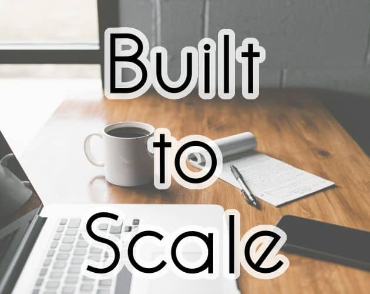

<p align="center">
  
</p>

# Built to Scale

[](https://github.com/remarkablegames/built-to-scale/releases)
[](https://github.com/remarkablegames/built-to-scale/actions/workflows/build.yml)
[](https://github.com/remarkablegames/built-to-scale/actions/workflows/lint.yml)

⚖️ Play as an entrepreneur building a business to scale!

> You're an entrepreneur with just 21 days to build a business that can scale. Make choices, manage your resources, and navigate the ups and downs of startup life. Grow too quickly and you could run out of money; play it too safe and you might miss your chance to grow.

Play in your browser:

- [Wavedash](https://wavedash.com/games/built-to-scale)
- [itch.io](https://remarkablegames.itch.io/built-to-scale)
- [Newgrounds](https://www.newgrounds.com/portal/view/945558)
- [remarkablegames](https://remarkablegames.org/built-to-scale/)

This was made for the [GMTK Game Jam 2024](https://itch.io/jam/gmtk-2024), which the theme was **Built to Scale** (see [submission](https://itch.io/jam/gmtk-2024/rate/2910953)).

Read the [blog post](https://remarkablegames.org/posts/built-to-scale/) or watch the [YouTube video](https://youtu.be/XXaQKrE2URU).

## Features

- A visual-novel story with RPG-style stats and choices
- A day-and-night cycle where every action spends energy and time
- Daily events that could help or hinder your business
- A 21-day run with multiple endings
- Estimated playtime: 30 minutes (5,000 words)

## Credits

### Art

- [Uncle Mugen](https://lemmasoft.renai.us/forums/viewtopic.php?t=17302)
- [Mad Scientist](https://twitter.com/mad_scientist92) ([NSAID](https://itch.io/c/4241605/free-art-assets-from-me))
- Photo by [Andrew Neel](https://unsplash.com/@andrewtneel) on [Unsplash](https://unsplash.com/photos/macbook-pro-white-ceramic-mugand-black-smartphone-on-table-cckf4TsHAuw)

### Audio

- [Kenney Interface Sounds](https://kenney.nl/assets/interface-sounds)
- [Text/Dialogue Bleeps Pack](https://dmochas-assets.itch.io/dmochas-bleeps-pack)
- Sound effects from Pixabay
  - [Cash Register (Kaching) - Sound Effect](https://pixabay.com/sound-effects/film-special-effects-cash-register-kaching-sound-effect-125042/)
  - [Cell Phone Vibrate (High Quality)](https://pixabay.com/sound-effects/cell-phone-vibrate-high-quality-34034/)
  - [Drink](https://pixabay.com/sound-effects/film-special-effects-drink-332368/)
  - [Eat](https://pixabay.com/sound-effects/people-eat-323883/)
  - [Knock knock knock](https://pixabay.com/sound-effects/knock-knock-knock-40474/)
  - [Person Running - LOOP](https://pixabay.com/sound-effects/film-special-effects-person-running-loop-245173/)
  - [Snoring](https://pixabay.com/sound-effects/people-snoring-71560/)
  - [Writing,Pen,Signature,Paper](https://pixabay.com/sound-effects/writingpensignaturepaper-102967/)
  - [cartoon bite](https://pixabay.com/sound-effects/film-special-effects-cartoon-bite-39234/)
  - [rotary phone ring medium](https://pixabay.com/sound-effects/rotary-phone-ring-medium-103869/)

### Font

- [Queensides Font](https://www.fontspace.com/queensides-font-f90306)

### Music

- Guilain de Coligny

## Ideation

- [Excalidraw](https://excalidraw.com/#json=y8nO6uwZN7OQLXonmG9WB,TJgAuz71GFU8QkH8YdFVoA)
- [Game Design Document](https://docs.google.com/document/d/12TN1zvyXvw51Xc1GbXCnBtvcRR2qjR-Qh1HAVmfVAPE/edit)

## Prerequisites

Download [Ren'Py SDK](https://www.renpy.org/latest.html):

```sh
git clone https://github.com/remarkablegames/renpy-sdk.git
```

Symlink `renpy`:

```sh
sudo ln -sf "$(realpath renpy-sdk/renpy.sh)" /usr/local/bin/renpy
```

## Install

Clone the repository to the `Projects Directory`:

```sh
git clone https://github.com/remarkablegames/built-to-scale.git
cd built-to-scale
```
## Run

Launch the project:

```sh
renpy .
```

Or open the `Ren'Py Launcher`:

```sh
renpy
```

Press `Shift`+`R` to reload the game.

Press `Shift`+`D` to open the developer menu.

## Cache

Clear the cache:

```sh
find game -type f -name '*.rpyc' -delete
```

Or open `Ren'Py Launcher` > `Force Recompile`:

```sh
renpy
```

## Lint

Lint the game:

```sh
renpy game lint
```
